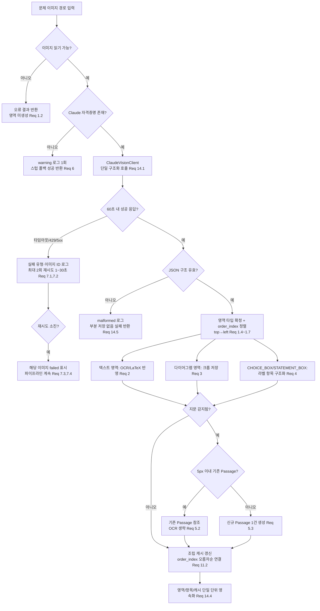
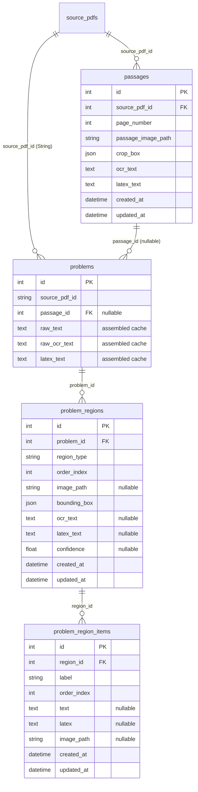

# Design Document

## Overview

이 기능은 하나의 문제 이미지를 **타입이 구분된 영역(region)들의 정렬된 집합**으로 분해하고, 각 영역의 OCR·LaTeX 텍스트와 라벨이 붙은 개별 항목(선택지 ①~⑤, `<보기>`의 ㄱ/ㄴ/ㄷ)을 추출하는 기능을 도입한다. 분해 작업은 Anthropic Claude Vision 모델을 **단일 구조화 호출**로 수행하며, 결과는 새로 도입하는 관계형 스키마(`passages`, `problem_regions`, `problem_region_items`, 그리고 `problems.passage_id` 외래키)에 저장된다. 기존의 단일 텍스트 필드(`raw_text`, `raw_ocr_text`, `latex_text`)는 영역 내용을 조립한 **파생 캐시(Assembled Cache)** 로 유지되어 하위 호환성을 보장한다.

이 설계는 requirements.md의 16개 요구사항을 다음과 같이 충족한다.

- 영역 탐지·타입 분류·바운딩 박스·정렬(Requirement 1)과 단일 호출 구조화 추출(Requirement 14)은 `ProblemRegionExtractionService`와 `ClaudeVisionClient`가 담당한다.
- 텍스트 영역 OCR/LaTeX(Requirement 2), 다이어그램 크롭(Requirement 3), 라벨 항목 구조화(Requirement 4)는 서비스의 오케스트레이션 단계로 처리한다.
- 지문 재사용(Requirement 5)과 조립 캐시(Requirement 11)는 `PassageRepository`와 캐시 조립 로직으로 구현한다.
- API 키 부재 시 안전한 폴백(Requirement 6), API 실패 복원력(Requirement 7), 설정(Requirement 13)은 `Settings`와 클라이언트/서비스의 오류 처리 경로로 처리한다.
- 새 영속 모델(Requirement 9), 이미지 경로 규칙(Requirement 10), 조회 API(Requirement 12), 하위 호환 인터페이스(Requirement 8), 테스트(Requirement 15), 문서(Requirement 16)는 각 컴포넌트 정의에 반영한다.

기존 코드베이스의 **엄격한 계층 구조(Router → Service → Repository → Model + Pydantic Schema)** 와 모델별 단일 리포지토리 규칙을 그대로 준수하며, `classification_service`, `generation_service`, `verification_service`는 수정하지 않는다.

## Architecture

### 컴포넌트 구성

기능은 기존 계층 구조 위에 다음 신규 컴포넌트를 추가한다.

- **`ClaudeVisionClient`** (`app/services/claude_vision_client.py`): 공식 `anthropic` Python SDK를 감싸는 얇은 래퍼. 단일 메서드로 이미지 + 프롬프트를 받아 구조화 JSON을 반환한다. 타임아웃(60초), 재시도(최대 2회, 1~30초 백오프), 자격증명 검사를 담당한다. 테스트에서 이 클래스만 목(mock) 처리하면 네트워크 호출이 전부 차단된다.
- **`ProblemRegionExtractionService`** (`app/services/problem_region_extraction_service.py`): 오케스트레이션 담당. 이미지 로드 검증 → 단일 Vision 호출 → 구조화 JSON 파싱 → 영역 타입 확정·정렬 → 텍스트 영역 OCR/LaTeX 반영 → 다이어그램 크롭 → 라벨 항목 구조화 → 지문 재사용 판단 → 조립 캐시 갱신 → 영속화를 순서대로 수행한다. 영역/지역의 원천(source of truth) 역할을 한다.
- **신규 리포지토리**: `PassageRepository`, `ProblemRegionRepository`, `ProblemRegionItemRepository` (모델별 단일 리포지토리 규칙 준수).
- **신규 모델**: `Passage`, `ProblemRegion`, `ProblemRegionItem`, 그리고 `Problem.passage_id` 추가.
- **신규 프롬프트**: `app/prompts/region_extraction_prompt.py` (단일 구조화 JSON 출력용 빌더 함수).
- **신규 스키마**: `PassageSchema`, `ProblemRegionItemSchema`, `ProblemRegionSchema`(항목 중첩), `ProblemRegionsResponse`.
- **라우터 확장**: `problem_router.py`에 `GET /{problem_id}/regions` 추가 (`/api/problems` 접두사 하에서 `GET /api/problems/{problem_id}/regions`로 노출).
- **스토리지 헬퍼 확장**: `app/core/storage.py`에 영역/항목 이미지 경로 헬퍼 추가.
- **설정 확장**: `app/core/config.py`에 `ANTHROPIC_API_KEY`(CLAUDE_API_KEY 폴백)와 `CLAUDE_VISION_MODEL` 프로퍼티 추가.

### 영역 추출 흐름



### 데이터 모델 관계 (ER)



### PDF 임포트 파이프라인 통합

영역 추출은 기존 임포트 흐름을 깨지 않도록 **문제 레코드 생성 이후의 후처리 단계**로 통합한다. `PDFImportService`가 `ProblemRepository.create_from_pdf()`로 문제를 만든 뒤, 문제별로 `ProblemRegionExtractionService.extract_regions(problem)`를 호출한다. 한 문제 이미지의 추출 실패(재시도 소진 포함)는 예외로 파이프라인을 중단시키지 않고 해당 문제만 `failed` 상태로 표시하며, 남은 문제 이미지는 계속 처리한다(Requirement 7.3, 7.4). 추출은 별도로 트리거 가능한 단계로도 설계하여, 이미 임포트된 문제에 대해 재실행할 수 있게 한다.

## Components and Interfaces

### ClaudeVisionClient

`anthropic` SDK를 감싸는 얇은 래퍼로, 서비스 로직과 네트워크·재시도 관심사를 분리한다. 테스트에서는 이 클래스의 단일 호출 메서드만 목 처리하여 네트워크를 완전히 차단한다(Requirement 15).

```python
# app/services/claude_vision_client.py
from dataclasses import dataclass
from typing import Optional

@dataclass
class VisionCallResult:
    success: bool
    raw_json: Optional[dict]      # 성공 시 파싱된 구조화 JSON
    failure_type: Optional[str]   # "timeout" | "rate_limited" | "server_error" | "malformed" | None
    error_message: Optional[str]

class ClaudeVisionClient:
    def __init__(self, api_key: str, model: str,
                 timeout_seconds: int = 60, max_retries: int = 2):
        ...

    def is_configured(self) -> bool:
        """자격증명 존재 여부. 없으면 서비스가 스텁 폴백으로 전환(Req 6)."""

    def extract(self, image_path: str, prompt: str) -> VisionCallResult:
        """이미지 + 프롬프트로 단일 구조화 호출(Req 14.1, 14.2).
        - 60초 타임아웃(Req 14.6)
        - timeout/429/5xx 시 최대 2회 재시도, 매 재시도 전 1~30초 대기(Req 7.1, 7.2)
        - 정상 동작 시 이미지당 호출 1회(Req 7.5, 14.2)
        - 응답 파싱 불가 시 failure_type='malformed'(Req 14.5)
        """
```

**설계 근거**: 재시도·백오프·타임아웃·JSON 파싱을 클라이언트 내부에 캡슐화하면 서비스는 순수 오케스트레이션 로직만 담당하고, 테스트는 `VisionCallResult`를 반환하는 목으로 모든 경로(성공/타임아웃/malformed)를 결정적으로 재현할 수 있다.

### ProblemRegionExtractionService

오케스트레이션 담당 신규 서비스. 계층 규칙에 따라 리포지토리를 통해서만 영속화한다.

```python
# app/services/problem_region_extraction_service.py
class ProblemRegionExtractionService:
    def __init__(self, db: Session, vision_client: ClaudeVisionClient | None = None):
        self.db = db
        self.vision_client = vision_client or ClaudeVisionClient(...)
        self.passage_repository = PassageRepository(db)
        self.region_repository = ProblemRegionRepository(db)
        self.item_repository = ProblemRegionItemRepository(db)
        self.problem_repository = ProblemRepository(db)

    def extract_regions(self, problem: Problem) -> RegionExtractionResult:
        """단일 문제에 대한 전체 추출 오케스트레이션.
        1. 이미지 읽기 검증(Req 1.2)
        2. 자격증명 없으면 스텁 폴백 + warning 로그 1회(Req 6.1, 6.4)
        3. 단일 Vision 호출(Req 14.1)
        4. JSON 구조 검증, malformed면 부분 저장 없이 실패(Req 14.5)
        5. region_type 확정 + order_index 정렬(top→left)(Req 1.4~1.7)
        6. 텍스트 영역 OCR/LaTeX(Req 2), 다이어그램 크롭(Req 3), 라벨 항목(Req 4)
        7. 지문 재사용/생성(Req 5)
        8. 조립 캐시 갱신(Req 11)
        9. 단일 단위 영속화(Req 14.4)
        """
```

`RegionExtractionResult`는 성공 여부, 생성된 영역 수, 영역 단위 오류 목록(부분 실패를 담되 전체 처리는 중단하지 않음, Requirement 2.6/3.5/3.6/4.7)을 포함한다.

**정렬 규칙**: 영역은 바운딩 박스 top 오름차순으로 정렬하고, top이 동일하면 left 오름차순으로 정렬한 뒤 0부터 연속·유일한 `order_index`를 부여한다(Requirement 1.6, 1.7). 라벨 항목도 동일 원리(위→아래, 그다음 좌→우)로 0-기반 연속 `order_index`를 부여한다(Requirement 4.3).

### 기존 스텁 인터페이스의 하위 호환 확장 (Requirement 8)

`OCRServiceInterface`, `LaTeXServiceInterface`, `CropClassifier`는 제거·개명·시그니처 변경 없이 그대로 유지한다. 신규 영역 분해 책임은 별도 서비스(`ProblemRegionExtractionService`)에 둔다. 만약 이 인터페이스들을 확장해야 한다면 기존 메서드는 그대로 두고 기본/선택 동작을 갖는 새 메서드만 추가하여, 원래 시그니처만 호출하는 기존 호출자가 수정 없이 동작하도록 한다(Requirement 8.2, 8.3, 8.5). `classification_service`, `generation_service`, `verification_service`는 수정하지 않는다(Requirement 8.4).

### 신규 리포지토리

기존 `ProblemRepository` 스타일(생성자에서 `Session` 주입, CRUD 메서드)을 따른다.

- **`PassageRepository`**: `find_matching(source_pdf_id, page_number, crop_box)` — 같은 source_pdf_id·page_number이고 crop_box 네 좌표가 각각 5px 이내로 일치하는 기존 지문 탐색(Requirement 5.1). `create(passage_data)`.
- **`ProblemRegionRepository`**: `create(region_data)`, `get_by_problem_id(problem_id)` — order_index 오름차순 정렬 반환(Requirement 12.1), `delete_by_problem_id(problem_id)` — 재추출 시 기존 영역 정리.
- **`ProblemRegionItemRepository`**: `create(item_data)`, `get_by_region_id(region_id)` — order_index 오름차순.

### 프롬프트 템플릿

`app/prompts/region_extraction_prompt.py`에 기존 프롬프트 모듈 스타일(문자열 반환 함수)로 빌더를 추가한다.

```python
# app/prompts/region_extraction_prompt.py
def build_region_extraction_prompt() -> str:
    """단일 구조화 JSON 출력을 지시하는 Claude Vision 프롬프트를 반환한다.
    출력 JSON에는 영역 배열이 포함되며 각 영역은 region_type, bounding_box
    {left, top, right, bottom}, ocr_text, latex_text, confidence, 그리고
    CHOICE_BOX/STATEMENT_BOX의 경우 라벨 항목 배열(label, text, latex,
    is_image)을 포함한다(Req 14.1, 14.3).
    """
```

### 스토리지 헬퍼

`app/core/storage.py`에 기존 스타일로 헬퍼를 추가한다(Requirement 10).

```python
def get_region_image_path(source_pdf_id: str, problem_id: int, region_id: int) -> Path:
    # uploads/problems/{source_pdf_id}/{problem_id}/regions/{region_id}.png
def get_item_image_path(source_pdf_id: str, problem_id: int, item_id: int) -> Path:
    # uploads/problems/{source_pdf_id}/{problem_id}/items/{item_id}.png
```

식별자(source_pdf_id, problem_id, region_id, item_id)가 비어 있으면 파일을 쓰지 않고 오류를 반환하며(Requirement 10.3), 대상 경로에 파일이 이미 있으면 덮어써 최신 이미지만 유지한다(Requirement 10.4).

### 설정 (Requirement 13)

`Settings` 클래스에 기존 `@property` 패턴으로 추가한다.

```python
class Settings:
    @property
    def ANTHROPIC_API_KEY(self) -> Optional[str]:
        # ANTHROPIC_API_KEY 우선, 없으면 CLAUDE_API_KEY 폴백(Req 6.2, 6.3, 13.2)
        return os.getenv("ANTHROPIC_API_KEY") or os.getenv("CLAUDE_API_KEY")

    @property
    def CLAUDE_VISION_MODEL(self) -> str:
        # 환경변수 CLAUDE_VISION_MODEL, 없으면 비전 지원 기본 모델명(Req 13.3)
        return os.getenv("CLAUDE_VISION_MODEL", "claude-3-5-sonnet-latest")
```

`requirements.txt`에 `anthropic`을 고정 버전(정확 버전 또는 최소 버전)으로 추가하고(Requirement 13.5), `.env.example`에 `ANTHROPIC_API_KEY`와 선택적 `CLAUDE_API_KEY`를 플레이스홀더로 문서화한다(Requirement 13.6).

### 라우터 및 스키마 (Requirement 12)

`problem_router.py`에 전용 엔드포인트를 추가한다.

```python
@router.get("/{problem_id}/regions", response_model=ProblemRegionsResponse)
async def get_problem_regions(problem_id: int, db: Session = Depends(get_db)):
    # 존재하지 않는 problem_id면 404(Req 12.4)
    # 영역 없으면 빈 리스트로 200(Req 12.5)
    # order_index 오름차순, 항목 중첩(Req 12.1)
```

스키마는 기존 `Problem` 스키마처럼 `Config.from_attributes = True`를 사용하며, 값이 없는 필드는 생략하지 않고 명시적 `null`로 표현한다(Requirement 12.3). `Optional[...]`은 기본값 `None`을 명시하여 항상 필드가 출력되도록 한다.

## Data Models

모든 신규 모델은 기존 `problem.py`와 동일하게 `from app.core.database import Base`로 Base를 가져온다. **Base는 `app/core/db_base.py`에 그대로 두며 이동하지 않는다**(과거 Base 이동이 MetaData 분리 → FK 파손을 유발한 이력 반영, Requirement 9.8).

### RegionType 열거형

```python
# app/models/problem_region.py
import enum

class RegionType(str, enum.Enum):
    QUESTION_TEXT = "QUESTION_TEXT"
    DIAGRAM = "DIAGRAM"
    CHOICE_BOX = "CHOICE_BOX"
    STATEMENT_BOX = "STATEMENT_BOX"
    TABLE = "TABLE"
    OTHER = "OTHER"
```

`ProblemStatus`와 동일하게 문자열 기반 enum(`str, enum.Enum`)으로 정의하고, 컬럼에는 `.value`(문자열)를 저장한다. 텍스트 영역은 `QUESTION_TEXT`, `CHOICE_BOX`, `STATEMENT_BOX`, `TABLE`이며 `DIAGRAM`은 다이어그램 영역이다.

### Passage 모델 (Requirement 9.1, 9.2)

```python
# app/models/passage.py
class Passage(Base):
    __tablename__ = "passages"
    id = Column(Integer, primary_key=True, index=True)
    source_pdf_id = Column(Integer, ForeignKey("source_pdfs.id"), nullable=False, index=True)
    page_number = Column(Integer, nullable=False)
    passage_image_path = Column(String, nullable=False)
    crop_box = Column(JSON, nullable=True)
    ocr_text = Column(Text, nullable=True)
    latex_text = Column(Text, nullable=True)
    created_at = Column(DateTime(timezone=True), server_default=func.now())
    updated_at = Column(DateTime(timezone=True), onupdate=func.now())
```

`id`, `source_pdf_id`, `page_number`, `passage_image_path`는 `nullable=False`로 강제하고(Requirement 9.2), `crop_box`, `ocr_text`, `latex_text`는 null 허용한다. `source_pdf_id`는 `source_pdfs.id`(정수 PK)를 참조하는 외래키다.

### ProblemRegion 모델 (Requirement 9.3)

```python
# app/models/problem_region.py
class ProblemRegion(Base):
    __tablename__ = "problem_regions"
    id = Column(Integer, primary_key=True, index=True)
    problem_id = Column(Integer, ForeignKey("problems.id"), nullable=False, index=True)
    region_type = Column(String, nullable=False)   # RegionType.value
    order_index = Column(Integer, nullable=False)
    image_path = Column(String, nullable=True)
    bounding_box = Column(JSON, nullable=False)     # {left, top, right, bottom}
    ocr_text = Column(Text, nullable=True)
    latex_text = Column(Text, nullable=True)
    confidence = Column(Float, nullable=True)
    created_at = Column(DateTime(timezone=True), server_default=func.now())
    updated_at = Column(DateTime(timezone=True), onupdate=func.now())
```

`confidence`는 Claude가 값을 반환하면 0.0~1.0으로 제약해 저장하고(Requirement 2.4), 반환하지 않으면 null로 둔다(Requirement 2.5).

### ProblemRegionItem 모델 (Requirement 9.4)

```python
# app/models/problem_region_item.py
class ProblemRegionItem(Base):
    __tablename__ = "problem_region_items"
    id = Column(Integer, primary_key=True, index=True)
    region_id = Column(Integer, ForeignKey("problem_regions.id"), nullable=False, index=True)
    label = Column(String, nullable=False)
    order_index = Column(Integer, nullable=False)
    text = Column(Text, nullable=True)
    latex = Column(Text, nullable=True)
    image_path = Column(String, nullable=True)
    created_at = Column(DateTime(timezone=True), server_default=func.now())
    updated_at = Column(DateTime(timezone=True), onupdate=func.now())
```

라벨은 원문 그대로 보존한다("①"~"⑤", "ㄱ"/"ㄴ"/"ㄷ", Requirement 4.1, 4.2). 항목이 텍스트면 `text`(+ 수식 시 `latex`)를 채우고 이미지면 `image_path`만 채운다(Requirement 4.4~4.6).

### Problem 모델 변경 (Requirement 9.5)

기존 `app/models/problem.py`에 다음 컬럼을 추가한다. 다른 필드·프로퍼티는 변경하지 않는다.

```python
from sqlalchemy import ForeignKey
passage_id = Column(Integer, ForeignKey("passages.id"), nullable=True, index=True)
```

기존 `raw_text`, `raw_ocr_text`, `latex_text`, `problem_image_path`, `page_image_path`, `crop_box`(JSON), `source_pdf_id`(String, 예 "PDF_XXXXXXXX"), `page_number`(Int)는 타입·값 그대로 유지된다(Requirement 11.1).

### create_tables() 레지스트리 갱신 (Requirement 9.6, 9.7)

`app/core/database.py`의 `create_tables()`는 모델 `__table__`을 수동 나열한다. 신규 세 모델을 import하고 `tables=[...]` 목록에 추가한다.

```python
from app.models.passage import Passage
from app.models.problem_region import ProblemRegion
from app.models.problem_region_item import ProblemRegionItem
# tables=[..., Passage.__table__, ProblemRegion.__table__, ProblemRegionItem.__table__]
```

세 테이블 중 하나라도 생성 실패 시 작업을 중단하고 실패 테이블을 식별하는 오류를 내며, 부분 생성 상태를 남기지 않도록 한다(Requirement 9.7).

### FK 무결성: PRAGMA foreign_keys=ON

SQLite는 기본적으로 외래키를 강제하지 않는다. `_init_engine()`에서 SQLAlchemy `connect` 이벤트로 연결마다 `PRAGMA foreign_keys=ON`을 실행하여 FK 무결성을 활성화하는 방식을 채택한다.

```python
from sqlalchemy import event
@event.listens_for(engine, "connect")
def _set_sqlite_pragma(dbapi_conn, _):
    cur = dbapi_conn.cursor(); cur.execute("PRAGMA foreign_keys=ON"); cur.close()
```

**설계 근거**: PRAGMA를 켜면 고아 레코드(존재하지 않는 problem_id를 참조하는 region 등)를 DB가 차단하므로, 리포지토리 수준의 수동 정리보다 안전하고 일관적이다. 이 이벤트는 `sqlite` URL일 때만 등록한다.

## Correctness Properties

*속성(property)이란 시스템의 모든 유효한 실행에서 참이어야 하는 특성 또는 동작을 말한다. 즉 시스템이 무엇을 해야 하는지에 대한 형식적 진술로서, 사람이 읽는 명세와 기계로 검증 가능한 정확성 보장 사이의 다리 역할을 한다.*

아래 속성들은 위의 prework 분석에서 PROPERTY로 분류된 항목을 기반으로 하며, 중복은 통합되었다. 각 속성은 파싱된 구조화 JSON(모의 응답)이나 순수 변환 함수 수준에서 검증하며, Claude API는 목으로 대체되어 네트워크 호출이 발생하지 않는다.

### Property 1: 모든 영역은 유효한 Region_Type을 갖는다

*임의의(For any)* 성공적으로 파싱된 Vision 응답에 대해, 생성된 모든 영역의 `region_type`은 집합 {QUESTION_TEXT, DIAGRAM, CHOICE_BOX, STATEMENT_BOX, TABLE, OTHER} 중 정확히 하나에 속한다.

**Validates: Requirements 1.4**

### Property 2: 영역 order_index는 (top, left) 정렬로 0-기반 연속·유일이다

*임의의(For any)* 영역 바운딩 박스 목록에 대해, 정렬·부여된 `order_index` 집합은 정확히 {0, 1, ..., n-1}이며(연속·유일·누락 없음), 영역을 `order_index` 순으로 나열하면 바운딩 박스가 (top, left) 사전식으로 비감소 순서를 이룬다.

**Validates: Requirements 1.6, 1.7**

### Property 3: confidence는 항상 null이거나 0.0~1.0 범위 내이다

*임의의(For any)* 영역 응답(음수·1 초과·누락 confidence 포함)에 대해, 저장된 `confidence` 값은 null이거나 0.0 이상 1.0 이하의 값이다.

**Validates: Requirements 2.4, 2.5**

### Property 4: 텍스트 영역은 OCR을 시도하고 실패는 격리된다

*임의의(For any)* 텍스트 영역 집합에 대해, 텍스트가 있는 영역은 추출된 `ocr_text`가 채워지고, 텍스트 추출에 실패하거나 빈 결과인 영역은 `ocr_text`·`latex_text`가 null로 남고 오류 표시가 생성되며, 어떤 영역의 실패도 나머지 영역의 처리를 중단시키지 않는다.

**Validates: Requirements 2.1, 2.6**

### Property 5: 다이어그램 영역은 OCR/LaTeX 텍스트를 갖지 않는다

*임의의(For any)* 성공적으로 파싱된 Vision 응답에 대해, `region_type`이 DIAGRAM인 모든 영역은 `ocr_text`와 `latex_text`가 모두 null이다.

**Validates: Requirements 3.1**

### Property 6: 바운딩 박스 클램프는 항상 경계 내이거나 무효 판정이다

*임의의(For any)* 바운딩 박스와 이미지 크기 (W, H)에 대해, 클램프 결과는 0 ≤ left < right ≤ W 및 0 ≤ top < bottom ≤ H를 만족하거나, 폭·높이가 1픽셀 미만이거나 면적이 0 이하가 되어 무효로 판정되어 크롭이 생략되고 `image_path`가 빈 값으로 남으며 오류가 표시된다.

**Validates: Requirements 3.4, 3.5**

### Property 7: 라벨 항목은 개수가 보존되고 라벨이 원문 그대로 유지된다

*임의의(For any)* 1~10개의 라벨 항목을 가진 CHOICE_BOX 또는 STATEMENT_BOX 영역에 대해, 생성된 Labeled_Item 수는 입력 항목 수와 같고, 각 항목의 라벨 문자열은 원문에 나타난 그대로("①"~"⑤", "ㄱ"/"ㄴ"/"ㄷ") 보존된다.

**Validates: Requirements 4.1, 4.2**

### Property 8: 라벨 항목 order_index는 읽기 순서로 0-기반 연속·유일이다

*임의의(For any)* 한 영역의 Labeled_Item 목록에 대해, 부여된 `order_index` 집합은 정확히 {0, 1, ..., m-1}이며(중복·누락 없음), 항목을 `order_index` 순으로 나열하면 원래 읽기 순서(위→아래, 그다음 좌→우)를 반영한다.

**Validates: Requirements 4.3**

### Property 9: 지문 매칭은 5픽셀 허용오차 규칙을 정확히 따른다

*임의의(For any)* 기준 crop_box(같은 source_pdf_id·page_number)와 후보 crop_box에 대해, 매칭으로 판정되는 필요충분조건은 네 좌표(left, top, right, bottom)의 차이가 각각 5픽셀 이하인 것이다. 하나라도 5픽셀을 초과하면 비매칭으로 판정된다.

**Validates: Requirements 5.1**

### Property 10: 정상 동작 시 이미지당 Claude 호출은 정확히 1회이다

*임의의(For any)* 성공적으로 처리되는 문제 이미지에 대해, 재시도가 발생하지 않는 정상 동작에서 `ClaudeVisionClient` 호출 횟수는 정확히 1이며, 영역 탐지·텍스트/LaTeX 추출·라벨 항목 파싱이 그 단일 호출의 구조화 JSON 출력으로 함께 반환된다.

**Validates: Requirements 7.5, 14.1, 14.2**

### Property 11: 재시도는 상한과 백오프 범위를 지킨다

*임의의(For any)* timeout/429/5xx 실패 시퀀스에 대해, 총 Claude 호출 횟수는 3회(원본 1회 + 재시도 최대 2회)를 초과하지 않으며, 각 재시도 전 대기 시간은 1초 이상 30초 이하이다.

**Validates: Requirements 7.2**

### Property 12: 이미지 저장 경로는 규칙 패턴을 따른다

*임의의(For any)* 비어 있지 않은 유효 식별자(source_pdf_id, problem_id, region_id 또는 item_id)에 대해, 생성된 저장 경로는 영역의 경우 `uploads/problems/{source_pdf_id}/{problem_id}/regions/{region_id}.png`, 라벨 항목의 경우 `uploads/problems/{source_pdf_id}/{problem_id}/items/{item_id}.png` 패턴과 정확히 일치한다.

**Validates: Requirements 10.1, 10.2**

### Property 13: 조립 캐시는 정렬된 영역 내용의 연결과 같다

*임의의(For any)* 한 문제의 영역 목록에 대해, 조립 캐시는 영역을 (order_index, region id) 사전식으로 정렬한 뒤 그 내용을 순서대로 연결한 결과와 정확히 같다. 영역이 없으면 캐시는 빈 값이 되고 오류 없이 완료된다.

**Validates: Requirements 11.2, 11.4, 11.6**

## Error Handling

오류 처리의 핵심 원칙은 **부분 실패 격리**(한 영역·한 문제의 실패가 전체를 중단시키지 않음)와 **원자성**(malformed·타임아웃 시 부분 저장 없음)이다.

| 상황 | 처리 | 관련 요구사항 |
| --- | --- | --- |
| Claude 자격증명 부재 | 기존 스텁 동작으로 폴백해 성공 반환, warning 로그 1회 | 6.1, 6.4 |
| 자격증명 우선순위 | ANTHROPIC_API_KEY 우선, 없으면 CLAUDE_API_KEY | 6.2, 6.3, 13.2 |
| API 호출 실패(timeout/429/5xx) | 실패 유형+이미지 ID 로그, 최대 2회 재시도(1~30초 백오프) | 7.1, 7.2 |
| 재시도 소진 | 해당 문제 이미지 `failed` 표시, 예외 없이 파이프라인에 제어 반환 → 나머지 이미지 계속 | 7.3, 7.4 |
| malformed JSON 출력 | malformed 로그, 실패 결과 반환, 해당 호출의 부분 데이터 미저장 | 14.5 |
| 60초 내 미응답 | 호출 중단, 타임아웃 로그, 부분 데이터 미저장 | 14.6 |
| 이미지 읽기 불가 | 이미지 로드 불가 오류 결과, 영역 미생성 | 1.2 |
| 텍스트 추출 실패/빈 결과 | 해당 영역 ocr_text·latex_text null, 오류 표시, 나머지 영역 계속 | 2.6 |
| 바운딩 박스 경계 초과 | 경계로 클램프 후 크롭 | 3.4 |
| 클램프 후 무효 박스 | 크롭 생략, image_path 빈값, 오류 표시 | 3.5 |
| 크롭 저장 실패 | image_path 빈값, 오류 표시, 나머지 영역 계속 | 3.6 |
| 라벨 미검출 | 항목 미생성, 오류 표시, 원본 영역 레코드 보존 | 4.7 |
| 지문 OCR 실패 | Passage 미저장, passage_id 미설정, 오류 반환 | 5.5 |
| 조립 캐시 실패 | 기존 raw_text/raw_ocr_text/latex_text 값 보존, 캐시 실패 오류 반환 | 11.5 |
| 이미지 경로 식별자 누락 | 파일 미기록, 누락 식별자 오류 반환 | 10.3 |
| create_tables 테이블 생성 실패 | 작업 중단, 실패 테이블 식별 오류, 부분 생성 미방치 | 9.7 |
| 존재하지 않는 problem_id 조회 | 404 응답, 영역 데이터 없음 | 12.4 |

## Testing Strategy

### 이중 접근

- **단위 테스트**: 특정 예시·엣지·오류 조건(위 prework의 EXAMPLE/EDGE_CASE/SMOKE 항목)을 검증한다. 자격증명 폴백, 지문 OCR 실패, malformed/타임아웃, 404, 빈 영역 리스트, 모델 필수 필드 제약 등이 해당한다.
- **속성 기반 테스트(PBT)**: 위 "정확성 속성"의 13개 보편 속성을 검증한다. 무작위 입력이 정렬 불변식, 클램프 경계, 매칭 허용오차, 조립 연결 등의 엣지를 드러낸다.

두 접근은 상호 보완적이다. 단위 테스트는 구체적 버그를, 속성 테스트는 일반적 정확성을 잡는다. 속성 기반 테스트에 지나치게 의존해 사소한 예시까지 속성으로 만들지 않으며, 반대로 보편 규칙을 예시로만 덮지 않는다.

### PBT 라이브러리 및 구성

- Python 대상이므로 **Hypothesis**를 사용한다(직접 구현하지 않음).
- 각 속성 테스트는 **최소 100회 반복**으로 구성한다(`@settings(max_examples=100)`).
- 각 속성 테스트에는 설계 문서의 속성을 참조하는 주석 태그를 단다.
  - 태그 형식: `# Feature: problem-region-vision-ocr, Property {번호}: {속성 텍스트}`
- 각 정확성 속성은 **단일 속성 기반 테스트**로 구현한다.

### Claude API 목킹 및 네트워크 차단 (Requirement 15)

- 모든 `ClaudeVisionClient` 호출은 테스트에서 목 객체로 대체하여 **네트워크 요청이 0건**이 되도록 한다(15.2). `ClaudeVisionClient.extract()` 하나만 목 처리하면 전체 경로가 결정적으로 재현된다.
- 미목킹 네트워크 시도를 감지하는 **가드 픽스처**를 둔다. 예를 들어 `anthropic` SDK의 HTTP 전송 계층 또는 소켓 연결을 패치해 실제 요청 시도 시 테스트를 실패시킨다(15.3). 이로써 네트워크가 없는 환경에서도 있는 환경과 동일한 결과를 얻는다(15.5).
- **모의 구조화 JSON 픽스처**: 영역 배열(각 region_type, bounding_box, ocr_text, latex_text, confidence)과 CHOICE_BOX/STATEMENT_BOX의 라벨 항목 배열을 담은 대표 응답, 그리고 malformed/빈/부분 실패 변형을 픽스처로 제공한다. Hypothesis 전략(strategy)으로 이 JSON을 무작위 생성해 속성 테스트에 공급한다.
- 신규 모델과 `ProblemRegionExtractionService`에 대해 **최소 80% 문장 커버리지**를 달성한다(15.1).
- 전체 스위트 실행 시 **기존 39개 테스트를 함께 실행**하며 모두 통과해야 한다(15.4). 신규 테스트는 `tests/` 디렉터리에 추가한다.

### PBT 비적용 부분

다음은 속성 기반 테스트가 아닌 다른 방식으로 검증한다.

- **스키마 생성(`create_tables()`, 신규 테이블 존재)**: 스모크 테스트 1회.
- **모델 제약(passages 필수 필드 null 거부)**: 예시 기반 단위 테스트(IntegrityError 확인).
- **API 실패 유형별 로깅·자격증명 우선순위·파이프라인 격리**: 목 기반 예시 테스트.
- **조회 API 라우팅(404, 빈 리스트, 정렬 반환)**: FastAPI 테스트 클라이언트 기반 예시/엣지 테스트(정렬 자체는 Property 2·13이 커버).

## Design Decisions / Rationale

### 결정 1: 스키마 마이그레이션 = 로컬 개발 DB 재생성 (사용자 확정)

Alembic을 도입하지 않고, 로컬 개발 DB(`math_problem_engine.db`)를 삭제한 뒤 `create_tables()`를 재실행하여 신규 테이블 3종과 `problems.passage_id` 컬럼을 반영한다. 이는 **로컬 개발 전용의 파괴적 작업**(기존 로컬 데이터 소실)이므로 문서에 명시하고, 운영 데이터에는 적용하지 않는다. 신규 세 모델(`Passage`, `ProblemRegion`, `ProblemRegionItem`)을 `create_tables()`의 수동 레지스트리(`tables=[...]`)에 반드시 추가한다(Requirement 9.6, 9.9). Alembic 초기화는 하지 않는다.

**근거**: 프로젝트가 아직 로컬 SQLite 개발 단계이고 마이그레이션 이력이 없어, 재생성이 가장 단순하고 오류 여지가 적다. 요구사항은 두 전략 중 정확히 하나를 적용하도록 허용하며(9.9), 여기서는 재생성을 택한다.

### 결정 2: 영역 조회 API = 전용 엔드포인트 (설계자 선택)

`GET /api/problems/{problem_id}/regions` 전용 엔드포인트를 신설하여, 정렬된 영역 목록에 라벨 항목을 중첩해 반환한다. 문제 목록/상세 응답(`GET /api/problems`, `GET /api/problems/{id}`)에 영역을 포함시키지 않는다.

**근거**: 기존 `problem_router.py`는 이미 `GET /{problem_id}` 같은 리소스 하위 경로 규칙을 쓰고 있어 전용 엔드포인트가 관례에 자연스럽게 들어맞는다. 또한 한 문제의 영역·항목 수가 많을 수 있어, 목록/상세 응답을 가볍게 유지하고 필요할 때만 영역을 조회하도록 분리하는 편이 성능·응답 크기 면에서 유리하다. 요구사항 12.1이 두 방식(전용 엔드포인트 또는 중첩 필드)을 모두 허용하므로 전용 엔드포인트를 채택한다.

### 결정 3: SQLite FK 강제 = PRAGMA foreign_keys=ON (권장)

SQLite는 기본적으로 외래키를 강제하지 않으므로, `_init_engine()`에서 SQLAlchemy `connect` 이벤트로 연결마다 `PRAGMA foreign_keys=ON`을 실행한다. 이 이벤트는 `sqlite` URL일 때만 등록한다.

**근거**: PRAGMA를 켜면 존재하지 않는 부모를 참조하는 고아 레코드(잘못된 problem_id를 가진 region 등)를 DB가 직접 차단하므로, 리포지토리마다 수동으로 고아를 정리하는 방식보다 일관적이고 안전하다. `Base`는 기존대로 `app/core/db_base.py`에 두어 reload로 인한 MetaData 분리·FK 파손을 방지하며, 신규 모델은 `from app.core.database import Base`로 Base를 가져와 기존 모델과 동일한 metadata에 등록되도록 한다.
