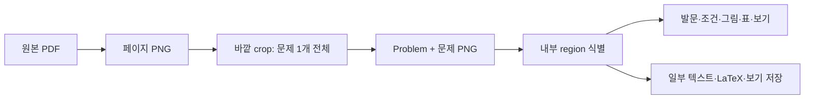

# PDF 문제 이미지의 바깥 crop과 내부 region crop

작성일: 2026-09-27 · 대상: 이 저장소를 처음 보는 개발자와 검토자 · 기준: 현재 구현

## 먼저 알아둘 핵심

이 프로젝트에는 서로 다른 두 번의 자르기가 있다.

| 단계 | 질문 | 입력 | 주된 결과 |
|---|---|---|---|
| **바깥 crop** | 한 PDF 페이지의 어느 부분이 **문제 하나 전체**인가? | 렌더링한 페이지 이미지 | `Problem` 한 건과 문제 이미지 PNG |
| **내부 region crop** | 그 문제 이미지 안에서 **발문·조건·그림·표·보기**는 각각 어디인가? | 승인된 문제 이미지 | `ProblemRegion`의 좌표·텍스트, 일부 별도 이미지 |

바깥 crop이 발문 첫 줄이나 보기를 빼먹으면 내부 region 단계는 그 내용을 복구할 수 없다. 따라서 **문제 전체가 빠짐없이 잘렸는지 먼저 확인**해야 한다. region은 문제를 다시 여러 문제로 나누는 기능이 아니다.

## 1. 바깥 crop: 페이지에서 문제 전체를 찾기

### 시작부터 저장까지

1. [`POST /api/pdf-import/upload`](../app/routers/pdf_import_router.py) 또는 저장된 PDF의 `reprocess` 요청이 [`PDFImportService`](../app/services/pdf_import_service.py)를 호출한다. `reprocess`는 원본 행을 덮어쓰지 않고 **새 `source_pdf_id`**를 만든다.
2. [`PageRenderService`](../app/services/page_render_service.py)가 PDF 각 페이지를 PNG로 렌더링한다. 기본 배율은 2배다. 페이지 이미지는 `uploads/pages/{source_pdf_id}/page_001.png` 등에 저장한다.
3. [`problem_crop_service.py`](../app/services/problem_crop_service.py)가 `{x,y,width,height}` 형태의 **페이지 이미지 픽셀 좌표**를 제안한다. 이 단계에서 아직 수학 풀이를 분석하지 않는다.
4. [`MockCropClassifier`](../app/services/crop_classifier_service.py)가 후보의 크기·위치 등으로 문제/머리말/꼬리말/보기 조각을 구분한다. `VisionLLMCropClassifier`는 구현되지 않은 자리표시자다. [`merge_classified_candidates`](../app/services/problem_candidate_merge_service.py)가 필요하면 보기 조각을 앞 문제와 합친다.
5. 겹침 검증 훅(설정이 켜진 경우)과 [`ProblemTextFilter`](../app/services/problem_text_filter_service.py)를 거쳐 PNG와 [`Problem`](../app/models/problem.py) 행을 저장한다. 문제 이미지는 `uploads/problems/{source_pdf_id}/P_000001.png` 형태다. `Problem.crop_box`와 `page_image_path`를 함께 저장해 원본 위치를 다시 볼 수 있다.

### 현재 후보 생성 방식 A: 번호 우선, 실패하면 이미지 휴리스틱

- [`detect_problem_numbers_from_pdf_page`](../app/utils/problem_number_detector.py)는 PDF 텍스트 레이어에서 `1.`~`30.` 형태를 찾는다. 각 번호의 PDF 좌표를 렌더링 배율 2에 맞춰 페이지 이미지 좌표로 바꾼다. 왼쪽·오른쪽 열에서 다음 번호 직전까지를 한 문제로 잡고 실제 잉크 범위로 위아래를 다듬는다.
- **한 페이지에서 번호가 2개 미만이면** 이 방법을 쓰지 않는다. 스캔본, 한 문제만 있는 페이지, `01` 형태의 교재 번호 등은 이미지 휴리스틱으로 넘어간다. 번호는 현재 코드의 우선 단서일 뿐 문제 crop의 필수 조건은 아니다.
- 이미지 휴리스틱은 OpenCV로 내용 덩어리를 찾고 열별로 묶는다. [`problem_block_grouping_service.py`](../app/services/problem_block_grouping_service.py)의 상단 12%·하단 6% 제외, 잉크 행, 덩어리 사이 거리, 크기 기준이 적용된다. 검출이 약하면 단순 열 분할을 사용한다.
- 이 휴리스틱은 시험지 배치에서는 통할 수 있지만, 제목 바로 아래에서 문제가 시작하는 교재, 여백이 큰 그림 문제, 스캔 자국이 있는 페이지에는 고정 경계가 맞지 않는다.

### 현재 방식 B: Gemini 페이지 검토

`reprocess?crop_mode=auto`를 호출하면 [`GeminiPageCropClient`](../app/services/gemini_page_crop_client.py)에 **원본 페이지 전체와 A안 박스를 그린 이미지**를 보낸다. Gemini는 A안 승인(`number_verified`), 페이지 전체 문제 박스 재제안(`gemini`), 불확실 판정 중 하나를 반환한다. 새 박스는 0~1000 비율 좌표를 픽셀로 바꾼 후 크기·겹침·번호 중복을 검사한다. 오류나 불확실 판정이면 기존 후보를 쓰면서 `needs_review`를 표시한다. `page_reports`는 현재 **요청 응답에만 포함**되고 페이지별 영구 검토 기록으로 저장되지 않는다.

**주의:** 일반 `/upload`는 기본적으로 `a_only`이며 Gemini 페이지 검토를 자동으로 실행하지 않는다. 반면 일반 업로드에서는 문제별 **내부 region 추출**을 시도한다. Claude 키가 있으면 이 호출은 실제 비용을 낼 수 있다. 재처리 경로는 현재 `extract_regions=False`라 내부 Vision 호출 없이 `full_problem`만 만든다.

### 이번 교재에서 드러난 오류의 예

`랑데뷰 n제 쉬사준킬 수2 일부.pdf`는 한 페이지에 하나 또는 두 문제를 싣고, 번호를 `01`처럼 표기한다. PDF에 텍스트 레이어는 있지만 번호 감지의 `1.` 규칙과 맞지 않고 일부 한글 추출도 깨져 있다. 첫 업로드 `PDF_6D620CF9`에서는 번호가 모두 `None`이었고, 페이지 상단의 문제 시작이 12% 제외선에 걸려 발문이 잘렸다. 종이의 가로 스캔 자국은 내용 덩어리로 오인되어 빈 crop도 저장됐다. 텍스트가 비어도 `STRICT_TEXT_FILTER`가 기본적으로 꺼져 있으면 저장하는 동작이 영향을 주었다. `auto` 재처리 `PDF_42AFC0F8`은 Gemini 박스로 01~12번을 분리했지만 일부 문제 이미지 아래에는 큰 빈 여백이 남는다.

## 2. 내부 region crop: 문제 안의 구성 요소를 찾기

### 무엇을 region이라 부르는가

한 `Problem` 안에 여러 [`ProblemRegion`](../app/models/problem_region.py)이 있을 수 있다. 예를 들면 발문, 조건 상자, 그림, 그래프, 표, 보기 묶음, 보기 한 개다. 이 저장소에는 과거의 대문자 유형(`QUESTION_TEXT`, `DIAGRAM`, `CHOICE_BOX`, `STATEMENT_BOX`, `TABLE`, `OTHER`)과 새 소문자 유형(`full_problem`, `question_body`, `condition_box`, `figure`, `graph`, `table`, `choice_group`, `choice_option`, `formula`, `passage`, `unknown`)이 **함께 존재**한다. 데이터 해석 시 두 세대를 구별해야 한다.

### 실제 처리 경로

1. [`ProblemRegionExtractionService.extract_regions`](../app/services/problem_region_extraction_service.py)는 저장된 **문제 PNG**를 입력으로 받는다. 키가 설정되어 있으면 현재는 **Claude Vision**을 한 번 호출해 영역 유형·경계·텍스트·LaTeX·신뢰도를 받는다. Gemini 페이지 crop과는 별개 호출이다. Claude 키가 없으면 성공 스텁으로 돌아오며 새 내부 영역은 추출하지 않는다.
2. Vision에 요구하는 경계는 문제 이미지 너비·높이에 대한 **0~1 비율 좌표**다. 서비스가 실제 문제 PNG 크기를 곱해 `{left,top,right,bottom}` 픽셀 좌표로 복원한다. 네 값 중 하나라도 1을 넘는 오래된 응답은 픽셀 좌표로 취급한다.
3. 유형과 좌표를 검증하고 위에서 아래 순으로 정렬한 뒤 `problem_regions`에 저장한다. 텍스트는 `ocr_text`·`latex_text`에, 하위 보기나 라벨은 `problem_region_items`에 저장한다. **모든 region을 별도 PNG로 저장하는 것은 아니다.** 현재 실제 이미지 crop 저장은 주로 `DIAGRAM` 영역에 적용된다.
4. [`ProblemOcrApplyService`](../app/services/problem_ocr_apply_service.py)는 `full_problem` 영역이 없으면 바깥 `Problem.crop_box`로 하나 생성한다. 객관식 보기가 충분히 추출되면 `ProblemChoice`를 갱신한다. 정답은 추측해서 저장하지 않는다.
5. `ENABLE_REGION_OVERLAP_VALIDATION=true`일 때만 영역 겹침 검증 훅이 작동한다. 기본값은 꺼져 있다. UI에서는 [`GET /api/problems/{id}/regions`](../app/routers/problem_router.py)로 저장된 영역을 볼 수 있고, 수동 재추출 API는 `POST /api/problems/{id}/extract-regions`다.

### 두 좌표계를 섞지 말 것

| 저장값 | 기준 이미지 | 표현 |
|---|---|---|
| `Problem.crop_box` | **페이지 PNG** | `{x,y,width,height}` 픽셀 |
| Claude가 추출한 `ProblemRegion.bounding_box` | **문제 PNG** | `{left,top,right,bottom}` 픽셀로 복원 |
| 자동 생성된 `full_problem` 영역 | 현재 코드에서는 `Problem.crop_box`를 복사하므로 **페이지 PNG** 좌표 | `{left,top,right,bottom}` 픽셀 |

따라서 같은 `ProblemRegion` 테이블이라도 `full_problem`과 세부 region은 **좌표 기준이 다를 수 있다.** 페이지 위에 세부 영역을 그리려면 문제 crop의 왼쪽·위쪽 좌표를 더해야 하고, 문제 PNG 위에 `full_problem`을 그리려면 반대로 빼야 한다. 앞으로 검토 UI를 만들 때 이 기준을 명시하고, 내부 영역 좌표 규약을 통일하는 작업을 별도 항목으로 다뤄야 한다.

## 3. 처음 보는 사람이 확인할 순서

1. PDF 원본 페이지와 `uploads/pages/{source_pdf_id}/page_XXX.png`를 비교한다.
2. 문제 PNG를 열어 **번호·발문 첫 줄·조건·그림·보기 끝**이 모두 있는지 확인한다. 빠진 부분이 있으면 바깥 crop부터 고친다.
3. `Problem.crop_box`를 페이지 PNG 위에 그려 누락·중복·제목 혼입을 찾는다. `imported` 상태나 `needs_review=False`만으로 사람의 검토가 끝났다고 판단하지 않는다.
4. 바깥 crop을 승인한 뒤에만 내부 region의 유형·경계·텍스트를 본다. `full_problem`이 있다는 사실만으로 Claude가 내부 구성 요소를 인식했다고 보지 않는다.

## 4. 다음 설계와의 연결

이 보고서는 **현재 동작**을 설명한다. 다음 변경 방향은 [PDF 문제 crop 검토 UI 구현 계획](CROP_REVIEW_UI_PLAN.md)에 기록했다. 그 계획에서는 여백·열 분석이 문제 후보를 만들고, Gemini가 전체 페이지를 검토한 다음, 사용자가 가운데 창에서 채택·버리기를 결정한다. 승인된 문제만 `Problem`으로 확정해 내부 region 단계로 넘긴다.
