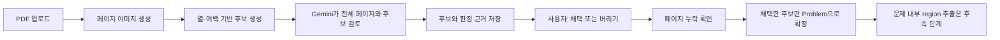

# PDF 문제 crop 검토 UI 구현 계획

작성일: 2026-09-27 · 상태: **단일 검토 화면으로 간소화**

구현 위치: `app/services/whitespace_crop_service.py`, `app/services/crop_review_service.py`,
`app/models/crop_review.py`, `app/repositories/crop_review_repository.py`,
`app/routers/pdf_import_router.py`, `app/static/admin/`. 기존 `/upload` API는 유지하고,
관리자 화면의 기본 업로드는 새 검토 경로를 사용한다. 페이지별 `confirm` API도 추가했다.

현재 여백 분리는 보수적인 큰 간격 기준이다. 번호에 의존하지 않으며, 번호 좌표를
보조 경계로 사용하는 최적화는 아직 없다. 교재 샘플에서 설명 영역 같은 오탐은
Gemini의 페이지 전체 검토와 사용자 판정 대상으로 남긴다. Gemini 키가 없으면
AI 없이 후보를 검토할 수 있다. 사용자는 기존 박스의 위치·크기를 직접 고치거나
새 박스를 그려 누락된 문제를 추가할 수 있다. 모든 페이지 후보 생성과 페이지별
미판정 후보 일괄 채택도 제공한다. 실제 Gemini 과금 호출과 브라우저 수동 검토는
배포 환경에서 확인해야 한다.

최신 UI에서는 업로드 후 전체 페이지 후보 생성을 자동으로 시작한다. 별도 카드·영역
수정 모달·페이지 확인 버튼을 노출하지 않고, 원본 페이지의 박스를 직접 조정한다.
오른쪽의 `버리기`는 선택 후보에만 적용하고 `채택하기`는 선택한 박스를 저장한 뒤
그 페이지의 미판정 후보를 함께 채택한다. 페이지 선택은 드롭다운으로 한다.

추가 API: `PATCH /api/pdf-import/crop-proposals/{id}/box`는 기존 후보의 페이지
픽셀 좌표를 저장하고 새 미리보기를 만든다. `POST /api/pdf-import/source-pdfs/{id}/crop-review/pages/{page}/proposals`는
직접 그린 후보를 추가한다. 두 동작은 후보를 채택 상태로 저장하고 페이지 확인을
다시 요구한다. `POST /api/pdf-import/source-pdfs/{id}/crop-review/pages/{page}/accept-all`은
이미 버린 후보를 유지하면서 나머지 미판정 후보를 채택하고 페이지를 확인한다.

## 목표와 이번 결정

사용자가 PDF를 넣으면 시스템이 **AI 없이 먼저 페이지의 열·내용 덩어리·여백을 분석해 넉넉한 문제 후보**를 만든다. 읽히는 문제 번호는 경계를 확인하는 보조 단서로만 쓴다. Gemini는 원본 **전체 페이지와 후보 박스**를 보고 그대로 둘지, 빠진 문제나 잘린 문제를 위해 박스를 다시 제안할지 판단한다. 마지막 결정은 사용자가 `/admin`의 가운데 검토 창에서 후보마다 **「채택」 또는 「버리기」**를 눌러 내린다.

이 접근을 택한 근거는 실제 `랑데뷰 n제 쉬사준킬 수2 일부.pdf`에서 확인했다. `01` 형식의 번호는 현재 `1.` 감지 규칙에 맞지 않았고, 기존 이미지 휴리스틱은 페이지 상단 12%를 제외해 문제 머리를 잘랐다. 첫 업로드 `PDF_6D620CF9`는 16개(빈 이미지 포함)를 저장했고, Gemini 재처리 `PDF_42AFC0F8`은 01~12번을 12개로 추출했다. **번호만 고쳐서는** 한 페이지에 문제가 하나뿐인 경우나 제목·풀이·그림 사이가 넓은 경우를 해결할 수 없다.

## 사용자가 보는 흐름

1. `/admin`의 **PDF 업로드** 화면에서 파일을 선택하고 「문제 검토 시작」을 누른다. 기존 「업로드 & 추출」은 당장 없애지 않고 기존 데이터와 사용법을 보존한다.
2. 페이지별 준비 상황을 보여준다. 여백 후보 생성은 서버에서 하고, Gemini 검토는 **한 페이지씩** 실행·저장한다. 창을 닫거나 새로고침해도 완료된 페이지부터 이어서 볼 수 있다. Gemini 키·호출 비용과 실패 상태를 화면에 표시한다.
3. 준비가 끝나면 검토 창이 화면 중앙에 열린다. 한 번에 **후보 하나**만 보여주며, 큰 crop 미리보기와 원본 페이지에서의 박스 위치를 함께 보여준다. 페이지 번호, 후보 순서, AI의 간단한 판단 근거, 전체 진행 수를 표시한다.
4. 아래의 결정 버튼은 **「채택」·「버리기」 두 개**로 제한한다. 결정은 즉시 저장되고 다음 후보로 이동한다. 닫기·이전·다음은 결정 버튼이 아니며, 미결정 후보는 그대로 남는다. 직전 결정은 검토 완료 전까지 바꿀 수 있다.
5. 페이지별 전체 박스를 보는 화면에서 **빠진 문제나 잘린 부분이 없는지** 확인한다. 두 버튼만으로는 아예 후보가 없는 문제를 발견·복구할 수 없으므로, 페이지 화면에는 별도의 「이 페이지 다시 제안받기」를 둔다. 새 제안은 기존 결정을 덮어쓰지 않고 새 버전으로 보관한다.
6. 모든 페이지를 확인한 뒤 「검토 완료」를 누르면 채택한 후보만 `Problem`에 등록된다. 버린 후보는 검토 기록으로 남고 문제함에는 나타나지 않는다. 문제 내부 region 추출은 이 시점 이후에만 선택적으로 실행한다.

### 가운데 검토 창의 기본 구성

| 위치 | 표시할 것 | 이유 |
|---|---|---|
| 상단 | 파일명, `3/12페이지 · 5/18후보`, 진행률 | 어느 페이지의 무엇을 판단하는지 유지 |
| 중앙 왼쪽 | 실제 저장될 크기의 crop 이미지, 확대 가능 | 글자·수식·보기·그림의 잘림 확인 |
| 중앙 오른쪽 | 원본 페이지와 현재 박스 강조 | 앞·뒤 문제나 제목이 섞였는지 확인 |
| 이미지 아래 | 제안 출처(여백·번호 보조·Gemini), Gemini 판단 이유, 불확실 표시 | 자동 판단을 맹신하지 않고 근거 확인 |
| 하단 고정 | 「버리기」, 「채택」 | 반복 검토를 단순하게 유지 |

창은 화면 중앙 정렬, 큰 이미지 영역, 키보드 초점 이동, 작은 화면에서 위·아래 배치를 지원한다. 기존 문제 상세 모달은 분류·메타데이터용으로 유지하고, **crop 검토 전용 모달**을 별도로 만든다.

## 서버 설계

### 1. 여백 중심 후보 생성

- 페이지의 세로 구분선이나 빈 통로를 먼저 찾아 열을 나눈다. 한 열만 있는 페이지도 허용한다.
- 각 열에서 글자·수식·그림의 잉크 영역을 묶는다. 가는 스캔 줄, 배경 음영, 페이지 바닥의 흔적은 문제 후보로 취급하지 않는다.
- 경계는 고정된 픽셀값이나 `상단 12%`로 자르지 않는다. 페이지마다 추정한 **글줄 높이와 내용 사이 간격**을 기준으로 긴 빈 구간을 후보 경계로 평가한다. 그림·표·선택지가 같은 문제에 속하면 내부 여백이 커도 함께 묶는다.
- 박스에는 안전 여백을 남긴다. 자동으로 넓힌 영역이 옆 열을 침범하지 않도록 열 경계에서 검사한다. 제목·주석은 우선 후보가 될 수 있으나, 빈 이미지에 가까운 후보는 사전에 제거한다.
- PDF 텍스트 번호가 안정적으로 읽힐 때만 보조 경계로 사용한다. `1.`, `01`, `01.` 등을 구별해 기록하고, 텍스트 좌표가 없거나 깨져도 후보 생성은 계속한다.
- 위 규칙으로 모든 페이지를 완벽하게 분리할 수 있다는 전제를 두지 않는다. 후보별 불확실성을 남기고 Gemini가 **전체 페이지를 보며** 승인하거나 박스를 다시 제안한다.

### 2. 후보와 판정을 별도로 저장

현재 [`PDFImportService`](../app/services/pdf_import_service.py)는 후보를 곧바로 `Problem` 행으로 저장한다. 새 검토 경로에는 `CropProposal`과 페이지별 `CropPageReview`를 **별도 테이블**로 둔다. 기존 `Problem` 행·이미지·API는 유지한다.

- `CropProposal`: ID, `source_pdf_id`, 페이지, 제안 버전, 원본 페이지 좌표의 `{x,y,width,height}`, 미리보기 경로, 표시용 문제 번호(선택), 제안 출처, Gemini 이유, `pending/accepted/discarded` 판정, 결정 시각.
- `CropPageReview`: `source_pdf_id`, 페이지, 준비 상태, Gemini 판정과 이유, 입력·출력 토큰, 후보 수, 사용자 페이지 확인 여부, 재제안 버전.
- `SourcePDF.status`: `preparing → awaiting_review → reviewed` 흐름을 사용하고 실패·보류 상태를 구분한다. 현재 `imported`는 처리 완료만 뜻하므로 사용자 승인과 혼동하지 않는다.
- 최종 확정 시 채택된 후보에서만 `Problem`과 문제 이미지, `full_problem` 영역을 만든다. 버린 후보에는 Claude region 추출·OCR을 실행하지 않는다. 최종 확정을 재시도해도 `Problem`이 중복되지 않게 제안 ID와 생성된 문제 ID를 연결한다.
- 새 테이블은 [`create_tables()`](../app/core/database.py)에 명시하고, 기존 DB에 컬럼을 더해야 한다면 백업과 별도 마이그레이션을 포함한다.

### 3. 제안할 API 계약

| 요청 | 역할 |
|---|---|
| `POST /api/pdf-import/review-uploads` | PDF 저장·페이지 렌더, 새 검토 작업 생성. 기존 `/upload`는 유지 |
| `POST /api/pdf-import/source-pdfs/{id}/crop-review/pages/{page}/prepare` | 해당 페이지만 여백 후보 생성 → Gemini 검토 → 제안 저장. 재호출은 기존 결과를 반환해 중복 과금 방지 |
| `GET /api/pdf-import/source-pdfs/{id}/crop-review` | 페이지별 진행 상태와 후보·미리보기 URL·결정 조회 |
| `PATCH /api/pdf-import/crop-proposals/{proposal_id}` | `accepted` 또는 `discarded` 기록. 같은 결정을 다시 보내도 결과 동일 |
| `POST /api/pdf-import/source-pdfs/{id}/crop-review/pages/{page}/retry` | 실패하거나 누락된 페이지를 새 버전으로 재제안 |
| `POST /api/pdf-import/source-pdfs/{id}/crop-review/finalize` | 미결정·미확인 페이지가 없는지 검사 후 채택 후보만 문제함에 등록 |

`prepare`를 페이지별 요청으로 나누면 긴 PDF에서 하나의 HTTP 요청이 오래 멈추는 일을 줄이고 중간 결과를 저장할 수 있다. 서버를 재시작해도 DB의 상태에서 이어서 진행한다. 이미지 URL은 현재 [`/uploads` 정적 경로](../app/main.py)를 재사용하되, `UPLOADS_ROOT`를 바꾼 환경에서도 같은 저장소를 가리키도록 경로 구성을 통일한다.

## 구현 순서와 완료 기준

1. **후보 생성기 교체**: 여백·열 기반 후보, 빈 후보 제거, 번호 보조 신호를 기존 함수와 분리해 구현한다. 기존 번호 기반·`auto` 경로는 보존해 비교한다.
2. **검토 데이터와 API**: 새 테이블·리포지토리·서비스·마이그레이션, 페이지별 준비와 결정, 재개·재시도·최종 확정을 구현한다.
3. **기존 관리자 UI 확장**: [`index.html`](../app/static/admin/index.html), [`app.js`](../app/static/admin/app.js), [`style.css`](../app/static/admin/style.css)에 업로드 진행 화면, 가운데 검토 창, 페이지 전체 확인, 결과 링크를 추가한다.
4. **검증**: 번호형 시험지(30문제), `01`형 교재(12문제), 한 문제만 있는 페이지, 그림 아래 큰 여백, 빈 페이지, 스캔 자국을 포함한 PDF로 후보 누락·잘림·빈 이미지 저장을 검사한다. Gemini는 모의 응답 테스트와 실제 소량 호출을 구분한다. 사용자가 채택·버리기·새로고침·재제안·완료를 거쳐도 기록이 중복되거나 사라지지 않아야 한다.

**범위:** 첫 UI는 바깥쪽 **페이지→문제 crop**을 검토한다. 문제 안의 글·그림·보기 **region crop** 검토 UI는 별도 단계로 설계한다. 바깥 crop이 승인되기 전에는 내부 region 추출을 시작하지 않는 것이 맞다.
